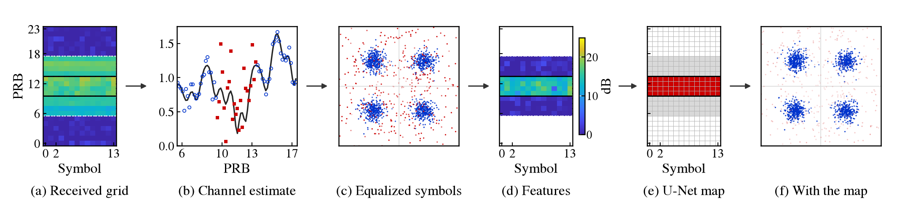

# Receiver-Informed Detection and Localization of Resource-Selective Jamming in the 5G NR Uplink

**[Project page](https://erhankarakoca.github.io/nr-jamming-localization/)** ·
[Results](docs/results.md) ·
[Reproduce](docs/reproducing.md) ·
[Proposal](docs/proposal.pdf) ·
[Open in Colab](https://colab.research.google.com/github/erhankarakoca/nr-jamming-localization/blob/main/notebooks/colab_setup.ipynb)

A jammer that knows the 5G NR frame structure can hit only the pilots (DMRS) or only the data of
an uplink slot. This project lets the gNB map such attacks in every slot, cell by cell over
PRBs × OFDM symbols, and then decode through them with the map. Everything is simulated in
[Sionna](https://nvlabs.github.io/sionna/) with the PyTorch backend.


<sub>One simulated slot with partial-band jamming on 4 of the user's 12 PRBs: (a) received grid,
(b) channel estimate, (c) equalized symbols, (d) features, (e) the U-Net's map, (f) decoding with
the map.</sub>

## How it works

1. **Three clues per cell**, from what the receiver already computes: received power, the DMRS
   residual (the part of the pilot estimates outside the channel's delay subspace) and the EVM
   of the equalized symbols. With no jamming, the channel inside that subspace and white noise
   of known power, the residual has a known distribution, which gives an analytic threshold.
2. **A small U-Net** (66,553 parameters), trained on block, hopping and pilot-comb jammers, three
   channel conditions and QPSK and 16-QAM, turns the clues into a 24 PRB × 14 symbol jamming map.
3. **Decoding through the attack**: the receiver estimates the jamming power of every cell from
   the energy that the user's signal and the noise do not explain, shrinks it towards the mean of
   its PRB (empirical Bayes, nothing to tune), gives the cell's bits less weight, and weights
   jammed pilots down by their residual. A map, when there is one, restricts the estimate to the
   flagged cells. When a block fails its CRC, data-aided passes use the decoder's output to refine
   the map, the noise power and the channel.
4. **Localization after decoding**: once a block decodes, every data symbol is known, and the same
   residual law tests every scheduled cell, whatever the shape of the attack.

## Results

| | Result | Conditions |
| --- | --- | --- |
| Detection | Cell-level F1 0.954 at 0.7% per-cell false alarms, 0.92 to 0.97 on hopping, pilot-comb, long-delay, fast and 16-QAM grids, and 0.82 on a pulsed jammer it never saw | Test grids (TDL-A and TDL-C, JSR −15 to +9 dB), three seeds (section 26 of the results) |
| Decoding | Block error rate 89.8% with the baseline receiver and 0.12% with the U-Net map and shrinkage, the same as with the true map | Pilot + data jamming at +9 dB JSR on 4 of 12 PRBs, TDL-C, 15 dB SNR, 30,720 slots (section 27 of the results) |
| Resolution and maps | Hopping data jamming: one jamming estimate per PRB fails on 51% of the slots, shrinkage without any map on none of 30,720. With 16-QAM the U-Net map lowers the block error rate by up to 12.6 percentage points over shrinkage alone and stays within 0.73 of the true map. With QPSK and every pilot jammed, an EVM map raises it by 29 points over shrinkage alone | +9 dB JSR, TDL-C, 15 dB SNR (QPSK) and 18 dB (16-QAM), one decoding attempt (section 27 of the results) |
| Unseen jammer | Pulsed jammer, in no training mix: at most 0.02% block errors with the U-Net map and shrinkage | +9 dB JSR, TDL-C, 15 dB SNR (section 27 of the results) |
| Jammer width | 0.06%, 2.1% and 38% with the map of the earlier U-Net, trained on block jammers and QPSK only, when 4, 6 and 8 of 12 PRBs are jammed, against 53%, 79% and 92% with the baseline receiver | Partial-band jamming at +3 dB JSR, TDL-C, 15 dB SNR (section 22 of the results) |
| Speed | 0.68 ms per slot to compute the features and run the U-Net | One core of an Apple M1 Pro, 24-PRB allocation; channel estimation, equalization and decoding not included |

These come from a synchronized, single-antenna simulation with known noise power.
[docs/results.md](docs/results.md) gives the operating point of each result and the cases where
the method does less well: multi-tone jammers, 16-QAM without a map, low link margin, and jammers
that cover most of the allocation.

## Quick start

```bash
curl -LsSf https://astral.sh/uv/install.sh | sh     # uv; for Windows see docs/development.md
git clone https://github.com/erhankarakoca/nr-jamming-localization.git
cd nr-jamming-localization
uv sync --locked
uv run pytest
```

[`notebooks/01_link_walkthrough.ipynb`](notebooks/01_link_walkthrough.ipynb) steps through one
slot. `paper_run` rebuilds the datasets, models and detection results of the earlier paper drafts
on a GPU:

```bash
uv run python -m jamloc.experiments.paper_run --seeds 0 1 2
```

The current paper reads the general training runs and the paper v9 runs (sections 26 and 27 of
the results), whose commands close [docs/reproducing.md](docs/reproducing.md). That file also
lists every other experiment, and
[docs/development.md](docs/development.md) covers Colab, VS Code, the code map and the Overleaf
paper.

## Repository

| Path | Contents |
| --- | --- |
| `src/jamloc/` | Link simulation, features, U-Net, baselines and the map-aware receiver |
| `src/jamloc/experiments/` | One script per experiment and figure |
| `site/` | The project page |
| `tests/` | pytest suite |
| `notebooks/` | One-slot walkthrough and Colab setup |
| `docs/` | Results log, claims register, plans, proposal |

Datasets and checkpoints are not committed: the scripts rebuild them in `data/` and `results/`
from recorded seeds. CPU and GPU runs can draw different samples and train different checkpoints.

---

CMPE 581 project, Boğaziçi University, Fall 2026 · Erhan Karakoca
